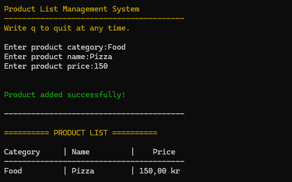
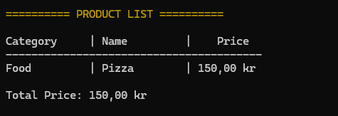
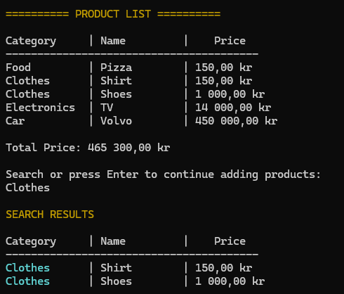
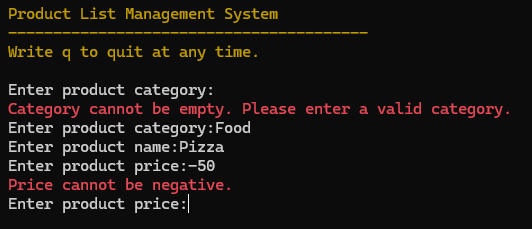

# Product List Management System

## Project Description

A C# console application for managing a product list. The user enters products with a category, name, and price. The application shows the list sorted by price, calculates the total price, and searches products by name or category.

Built for Weekly miniproject Week 44.
The project practices object-oriented programming, collections, LINQ, and error handling.

## Features

- Add products with a category, name, and price. Keep adding until you type q.
- View all products in a formatted table, sorted from lowest to highest price.
- See the total price of all products.
- Search by product name or category. Matching is case-insensitive and partial.
- Highlight the search term in cyan in the search results.
- Validate input: empty category, empty name, non-numeric price, and negative price.
- Show errors in red, success messages in green, and headings in dark yellow.
- Type q at any prompt to quit.
- Display prices in the currency format of the system region, for example kr in Sweden.

## Technologies

- C#
- .NET 10 (net10.0)
- LINQ (OrderBy, Sum, Where)
- Console API for input, output, and colors
- Visual Studio Code

### Project Structure

- Program.cs: entry point, input loop, validation, and search display
- Product.cs: Product class with Category, Name, and Price
- ProductManager.cs: AddProduct, ShowProducts, CalculateTotal, and SearchProduct

## Installation

1. Install the .NET 10 SDK from https://dotnet.microsoft.com/download.
2. Clone the repository:

```bash
git clone https://github.com/lorriluring/ProductListManagementSystem.git
```

3. Go to the project folder:

```bash
cd ProductListManagementSystem
```

## How to Run

1. Open a terminal in the project folder.
2. Start the application:

```bash
dotnet run
```

3. Enter a category, a name, and a price.
4. Review the product list and the total price.
5. Enter a search term, or press Enter to add another product.
6. Type q to quit.

### Example

```text
Product List Management System
----------------------------------------
Write q to quit at any time.

Enter product category:Electronics
Enter product name:Keyboard
Enter product price:599

Product added successfully!

----------------------------------------

========== PRODUCT LIST ==========

Category     | Name         |    Price
----------------------------------------
Electronics  | Keyboard     | 599,00 kr

Total Price: 599,00 kr

Search or press Enter to continue adding products:
```

## Screenshots
## Adding a product


## Product list and total price


## Search results with highlighting


## Examples of error handling


## Team Members

- [Johan Lorentz](https://github.com/lorriluring)

## Future Improvements

- Give each product a unique ID.
- Edit and delete products by ID.
- Save and load products with JSON.
- Add a statistics view: most expensive product, cheapest product, average price, and count per category.
- Add a menu-based console system.
- Add sort direction, price range filter, and pagination.
- Add unit tests.
